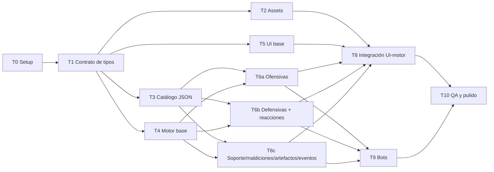

# Not Enough Mana: versión digital

Documento de requerimientos, recursos y plan de tareas para construir una versión digital del juego de cartas **Not Enough Mana**, partiendo de la edición *Print & Play*.

> 🔁 **Cambio de stack (2026-10-12):** el proyecto se hace en **Godot 4 + Firebase**, con multijugador en línea (el celular anfitrión es la autoridad) y exportación a Android y Web. Las secciones 4.3, 4.4, 5 y 8 de este documento quedan sustituidas por `docs/ARQUITECTURA.md` y `docs/CONTEXTO-AGENTES.md`. Las reglas (secciones 1-3) y los RF1-RF11 siguen vigentes, y el multijugador en línea pasa de v2 al MVP.

> ⚠️ **Derechos:** el arte y los textos son © SUPERHOTEX sp. z o.o. (concepto de Paweł Piskorski). Este proyecto es para **uso personal**; no se debe publicar ni distribuir con sus assets.

---

## 1. Resumen del juego

- Juego de cartas para **3-6 magos**. Cada jugador se enfrenta a los demás con hechizos, maldiciones y artefactos.
- **Objetivo:** eliminar a todos los demás magos, ya sea dejándolos sin vida o por K.O. (*Too Much Mana*).
- **Recursos de cada jugador:** 💖 vida (empieza en 10, que también es el máximo) y 💧 maná (empieza en 0 y no tiene límite).
- **Pociones de maná:** se pueden "beber" en cualquier momento, incluso fuera del turno propio. Cada una da **+3 maná** (valor configurable). Si se acaban los cristales del pool común, las pociones no dan nada.

### 1.1 Preparación

1. Barajar el mazo y dejarlo boca abajo como pila de robo. Al lado va la pila de descarte, boca arriba.
2. Cada mago empieza con 10 de vida.
3. Cada mago roba 5 cartas. Si le sale un **Evento**, lo descarta y roba otra en su lugar.
4. Empieza el mago de más edad y el turno avanza en sentido horario.

### 1.2 Turno

1. **Robar** hasta el límite de mano (normalmente 5).
   - Si se roba un **Evento**, se lee, se pone en el centro de la mesa, se aplica su efecto y se roba otra carta en su lugar.
   - Si el mazo se acaba, se baraja el descarte y pasa a ser el nuevo mazo.
2. **Acciones**, en cualquier orden y tantas veces como se quiera:
   - **Jugar una carta:** pagar su coste (maná y/o cartas requeridas), elegir el objetivo y aplicar el efecto. Después la carta y las cartas usadas para pagar van al descarte. Los artefactos, algunas maldiciones y los eventos se quedan en la mesa mientras dure su efecto.
   - **Descartar** cualquier número de cartas.
   - **Intercambiar** una carta: se descarta, se paga el coste y se roba otra nueva. El coste es **1 maná el primer intercambio del turno, 2 el segundo, 3 el tercero…**
3. **Anunciar el fin del turno.**

### 1.3 Reglas especiales

- Todos los hechizos con objetivo también se pueden lanzar sobre uno mismo.
- Si un efecto obliga a descartar y no tienes cartas en la mano, pierdes **1 maná** por cada carta que no puedes descartar.
- Si debes perder más maná del que tienes, tienes que beber una poción en ese momento. Si no lo haces, pierdes tanta **vida** como maná te falte.
- Las cartas **defensivas** se pueden jugar en cualquier momento, también fuera del turno propio, como respuesta a un hechizo.
- Te eliminan si te quedas en 0 de vida o si tienes *Too Much Mana*.

### 1.4 Variantes

- **Por equipos** (4 o 6 jugadores, 2 o 3 equipos): los turnos se alternan entre equipos y gana el último equipo en pie.
- **Conjunción astral:** los magos eliminados pueden beber pociones, y cada una quita 1 de maná a todos los vivos.

---

## 2. Recursos disponibles

Todo está en `~/Downloads/Not Enough Mana Print & Play Edition/`.

| Recurso | Archivo | Uso |
|---|---|---|
| Cartas individuales (165 págs, 1 carta/pág) | `Cards/P&P cards - singles ISO.pdf` | **Fuente principal**: renderizar cada página a PNG/WebP |
| Cartas con sangrado | `Cards/P&P cards - singles ISO with bleed.pdf` | Alternativa con más margen |
| Reverso de carta | `Cards/P&P cardbacks - singles ISO.pdf` | Imagen del dorso (basta con 1 página) |
| Manual (16 págs) | `Manual/P&P Manual - single page.pdf` | Reglas (resumidas en la sección 1) |
| Wallpapers ×4, avatar, portada | `Extras/*.png`, `NEM P&P Cover.jpg` | Fondo de la mesa, pantalla de inicio y avatar de jugador |
| Caja | `Box/*.pdf` | Opcional: imagen del logo |

**Herramientas instaladas:** `pdftoppm`, `pdftotext`, `pdfimages` (poppler).

**Formato físico de las cartas:** póker, 6,35 × 8,9 cm (proporción ≈ 0,714).

### 2.1 Qué se puede extraer automáticamente y qué no

- ✅ Nombre, encantamiento y texto del efecto: se extraen con `pdftotext` página por página.
- ❌ Los **iconos** son imágenes: 💖 vida, 💧 maná y los iconos de tipo de carta (fuego, hielo, electricidad, maldición, etc.). En el texto extraído aparecen como huecos (por ejemplo, "The target loses 2 ."). Hay que **completarlos mirando la imagen de la carta**.
- ❌ El **coste**, que va en una banda entre la ilustración y el nombre (por ejemplo, `2💧 + 1 carta de maldición`), es solo imagen. Hay que transcribirlo a mano.
- ❌ El **elemento** del hechizo (fuego, hielo o electricidad) se deduce del color o arte de la carta y de su sección en el PDF.

### 2.2 Catálogo de cartas (165 en total, 60 diseños distintos)

Las páginas corresponden a `P&P cards - singles ISO.pdf`.

| Págs | Cant. | Carta | Tipo | Efecto (resumido) |
|---|---|---|---|---|
| 1-6 | 6 | Referencia rápida | No jugable | Resumen de reglas (no va al mazo) |
| 7-10, 165 | 5 | Cartas vacías / Anti-Joker | No jugable | Se quedan fuera del mazo (revisar visualmente) |
| 11-18 | 8 | Fire Arrow | Ofensiva 🔥 | Objetivo −1💖 |
| 19-24 | 6 | Fireball | Ofensiva 🔥 | Objetivo −2💖 |
| 25-27 | 3 | Meteor Shower | Ofensiva 🔥 | Objetivo −2💖; los vecinos −1💖 |
| 28 | 1 | Armageddon | Ofensiva 🔥 | Todos (incluido el que la lanza) −3💖 |
| 29-30 | 2 | Mana Implosion | Ofensiva 🔥 | Objetivo −2💖 y −2💧 |
| 31-36 | 6 | Ice Bolt | Ofensiva ❄️ | Objetivo −1💖 y descarta 1 carta |
| 37-39 | 3 | Blizzard | Ofensiva ❄️ | Objetivo y vecinos −1💖 y descartan 1 |
| 40-42 | 3 | Ice Boomerang | Ofensiva ❄️ | Objetivo −3💖; quien la lanza −1💖 |
| 43-47 | 5 | Vampiric Touch | Ofensiva ❄️ | Objetivo −2💖; quien la lanza +1💖 |
| 48-49 | 2 | Freeze | Ofensiva ❄️ | El objetivo pierde su próximo turno |
| 50-51 | 2 | Icy Grasp | Ofensiva ❄️ | Objetivo −2💖; robas 1 carta al azar de su mano |
| 52-61 | 10 | Lightning | Ofensiva ⚡ | Objetivo −2💖. El objetivo puede responder con otro Lightning: +1 de daño y lo redirige a otro mago |
| 62-64 | 3 | Electric Explosion | Ofensiva ⚡ | Todos menos quien la lanza −2💖 |
| 65-66 | 2 | Blinding Flash | Ofensiva ⚡ | Objetivo −2💖; no puede lanzar ofensivas en su próximo turno |
| 67-71 | 5 | Electric Arc | Ofensiva ⚡ | 2 objetivos −1💖 cada uno |
| 72-73 | 2 | Paralysing Touch | Ofensiva ⚡ | Objetivo −2💖 y descarta 2 cartas |
| 74-84 | 11 | Magic Shield | Defensiva | Previene 2 de daño de hechizo |
| 85-89 | 5 | Mirror Shield | Defensiva | Redirige hasta 2 de daño a cualquier mago |
| 90 | 1 | Frozen Bunny | Defensiva | Previene todo el daño de un hechizo |
| 91 | 1 | Last Wish | Defensiva | Si un hechizo te mata, el atacante recibe el mismo daño |
| 92-94 | 3 | Magic Capture | Defensiva | Robas la carta de arriba del descarte |
| 95-96 | 2 | Annihilation | Defensiva | Descarta cualquier carta en juego (incluido un hechizo en curso) |
| 97-106 | 10 | Heal | Soporte | Objetivo +1💖 |
| 107-110 | 4 | Greater Heal | Soporte | Objetivo +2💖 |
| 111-112 | 2 | Book Exchange | Soporte | Intercambias tu mano con la de otro mago |
| 113-114 | 2 | Magic Hand | Soporte | Ves la mano de otro mago y le robas 1 carta |
| 115-117 | 3 | Force Field | Soporte | El objetivo es inmune a hechizos hasta tu próximo turno |
| 118-121 | 4 | Potent Elixir | Soporte | Tu próxima poción da el doble de 💧 |
| 122-123 | 2 | Space Shift | Soporte | Descartas tu mano y robas una nueva |
| 124-126 | 3 | Curse of Rules | Maldición | Pones una regla; quien la rompa −1💧 (persistente) |
| 127 | 1 | Curse of the Elder | Maldición | Los mayores que quien la lanza −3💧 |
| 128 | 1 | Curse of the Younger | Maldición | Los menores que quien la lanza −3💧 |
| 129 | 1 | Curse of Vigour | Maldición | Quienes tengan ≥ 💖 que quien la lanza −3💧 |
| 130 | 1 | Curse of Even | Maldición | Los nacidos en mes par −3💧 |
| 131 | 1 | Curse of Odd | Maldición | Los nacidos en mes impar −3💧 |
| 132 | 1 | Fireproof Tiara | Artefacto | −1 al daño de fuego que recibes |
| 133 | 1 | Padded Boots | Artefacto | −1 al daño de hielo que recibes |
| 134 | 1 | Faraday's Cloak | Artefacto | −1 al daño eléctrico que recibes |
| 135 | 1 | Wild Fire | Artefacto | Tus hechizos de fuego hacen +1 |
| 136 | 1 | Dragon Glass | Artefacto | Tus hechizos de hielo hacen +1 |
| 137 | 1 | Tesla Coil | Artefacto | Tus hechizos eléctricos hacen +1 |
| 138-140 | 3 | Spellbook | Artefacto | Límite de mano +1 (máximo 1 por jugador) |
| 141-143 | 3 | Magic Cap | Artefacto | Lo descartas para evitar una pérdida de 💖 o 💧, una sola vez |
| 144 | 1 | Runic Armor | Artefacto | Inmunidad a maldiciones |
| 145-151 | 7 | Scroll of Elements | Artefacto | Sustituye a cualquier carta requerida en un coste (un solo uso) |
| 152 | 1 | Transformation Glove | Artefacto | 1 vez por turno: descartas 1 carta y robas 1 |
| 153 | 1 | Twardowsky's Mirror | Artefacto | 1 vez por turno: miras la carta de arriba del mazo |
| 154 | 1 | Visit of the Archmage | Evento | Todos −2💖, salvo quien beba una poción en ese momento |
| 155 | 1 | Not Enough Mana | Evento | Hasta el próximo evento, cada daño también quita el mismo 💧 |
| 156 | 1 | Shot Glass | Evento | Hasta el próximo evento, las pociones dan 1 menos |
| 157 | 1 | Fire Storm | Evento | Hasta el próximo evento, el fuego cuesta +1 y hace +1 |
| 158 | 1 | Ice Storm | Evento | Lo mismo para el hielo |
| 159 | 1 | Lightning Storm | Evento | Lo mismo para la electricidad |
| 160 | 1 | Mana Focus | Evento | Hasta el próximo evento, puedes pagar con 💧 el daño que recibes |
| 161 | 1 | Disrupted Gravity | Evento | Hasta el próximo evento, el límite de mano es +1 para todos |
| 162 | 1 | Blessing | Evento | Todos +2💖 |
| 163 | 1 | Warp Discharge | Evento | El mago con menos 💧(?) −1, los demás +1 (verificar icono) |
| 164 | 1 | Elixir Transmutation | Evento | Todos pueden comprar 💖 a 2💧 cada uno (verificar) |

> Los iconos marcados como 💖 o 💧 en las maldiciones y eventos son una **suposición**. Hay que confirmarlos con la imagen de cada carta en la tarea T3.

---

## 3. Adaptaciones al formato digital

Hay mecánicas que dependen del mundo real y necesitan una regla digital:

| Mecánica física | Propuesta digital |
|---|---|
| Beber una poción (alcohol) | Botón **"Beber poción"** disponible siempre, también fuera del turno propio. Lleva un contador de pociones por jugador. |
| K.O. por *Too Much Mana* (borrachera) | Límite configurable de pociones por partida (por ejemplo, 10). Al superarlo, el jugador queda eliminado. También se puede desactivar. |
| Pool común de cristales (70 de vida y 70 de maná) | Se simula con un contador global. Si el maná del pool llega a 0, las pociones no dan nada. |
| Maldiciones por edad o mes de nacimiento | Al crear cada jugador se pide su **edad** y su **mes de nacimiento**. |
| Curse of Rules (regla inventada) | Texto libre y un botón **"Rompió la regla"** que resta 1💧. Otra opción es sacarla del mazo. |
| Jugar defensivas fuera de turno | **Ventana de reacción:** cuando se lanza un hechizo, cada jugador que pueda responder tiene unos segundos o un botón para pasar. |
| "El mago de más edad empieza" | Se usa la edad registrada. |
| Cartas vacías y Anti-Joker | Quedan fuera del mazo en la v1. |

---

## 4. Requerimientos

### 4.1 Funcionales (MVP)

- **RF1:** Configurar una partida con 3-6 jugadores (nombre, edad, mes de nacimiento, humano o bot).
- **RF2:** Mazo de 154 cartas jugables (sin referencia rápida, vacías ni Anti-Joker), barajado con Fisher-Yates.
- **RF3:** Reparto inicial que relanza los eventos, y vida inicial de 10.
- **RF4:** Ciclo de turno completo: robar hasta el límite, eventos al robar, rebarajar el descarte, jugar, descartar, intercambiar con coste creciente y terminar el turno.
- **RF5:** Pago de costes con maná y cartas requeridas, incluido el Scroll of Elements como comodín.
- **RF6:** Los efectos de las 60 cartas implementados, incluidos los modificadores de artefactos y eventos.
- **RF7:** Ventana de reacción para defensivas, el encadenamiento de Lightning y Annihilation.
- **RF8:** Pociones en cualquier momento, maná insuficiente que se convierte en daño a la vida, y eliminación y victoria.
- **RF9:** Interfaz de mesa: mano propia, rivales con vida, maná y número de cartas, artefactos equipados, evento activo, mazo, descarte y registro de acciones.
- **RF10:** Hot-seat local: varios humanos en un mismo dispositivo, con una pantalla "pasa el dispositivo" que oculta la mano.
- **RF11:** Bots con IA básica para jugar solo.

### 4.2 Opcionales (v2)

Variante por equipos, conjunción astral, animaciones, sonido, guardar y cargar partidas, multijugador en red, editor de cartas vacías.

### 4.3 No funcionales

- Se juega en el navegador, en escritorio y móvil.
- Motor **puro y testeable**, separado de la interfaz (estado + acciones → nuevo estado).
- Cada carta se define con **datos (JSON) y un efecto registrado por id**, de modo que agregar una carta no obliga a tocar el motor.
- Tests unitarios del motor y de cada efecto.

### 4.4 Stack propuesto (modificable)

- **TypeScript + Vite + React** para la interfaz, y TypeScript puro para el motor.
- **Vitest** para los tests.
- Assets en `public/cards/NNN.webp`.

---

## 5. Arquitectura y estructura de carpetas

```
not-enough-mana/
├─ REQUERIMIENTOS.md
├─ scripts/
│  └─ extract-assets.sh        # PDF → imágenes
├─ public/
│  ├─ cards/001.webp … 165.webp
│  ├─ cardback.webp
│  └─ bg/ (wallpapers, avatar, portada)
├─ src/
│  ├─ engine/                  # Motor puro, sin dependencias de UI
│  │  ├─ types.ts              # ⭐ CONTRATO compartido (T1)
│  │  ├─ deck.ts               # barajar, robar, rebarajar
│  │  ├─ game.ts               # estado, turnos, acciones, reducer
│  │  ├─ damage.ts             # daño, modificadores, maná → vida
│  │  ├─ reactions.ts          # ventana de reacción / pila
│  │  └─ effects/
│  │     ├─ registry.ts        # id de carta → función de efecto
│  │     ├─ fire.ts  ice.ts  electric.ts
│  │     ├─ defensive.ts  support.ts  curses.ts
│  │     ├─ artifacts.ts  events.ts
│  ├─ data/cards.json          # Catálogo (T3)
│  ├─ ai/bot.ts                # IA (T9)
│  └─ ui/                      # Componentes React (T5, T8)
└─ tests/
```

**Regla para trabajar en paralelo:** cada tarea toca solo sus propios archivos. El único archivo compartido es `engine/types.ts`, que se define en T1 y después solo se modifica con cambios coordinados.

---

## 6. Plan de tareas

Las tareas se agrupan en **oleadas**. Las de una misma oleada se pueden asignar a subagentes en paralelo, y cada oleada empieza cuando termina la anterior.



### Oleada 0: base (secuencial, 1 agente)

**T0. Setup del proyecto**
- Crear el proyecto con Vite + React + TS, configurar Vitest, ESLint y Prettier, y crear la estructura de carpetas de la sección 5.
- ✅ Hecho cuando: `npm run dev` y `npm test` funcionan.

**T1. Contrato de tipos (`src/engine/types.ts`)**
- Definir `CardDef` (id, nombre, tipo, elemento, encantamiento, coste {mana, cartasRequeridas[]}, texto, cantidad, páginas, `persistent`, `defensive`), además de `CardInstance`, `Player`, `GameState`, `Action`, `EffectFn`, `ReactionWindow` y `GameConfig`.
- Definir la firma de los efectos: `(state, ctx) => state`.
- ✅ Hecho cuando: compila y está documentado con comentarios. **Bloquea todo lo demás.**

### Oleada 1: 4 agentes en paralelo

**T2. Extracción de assets** (agente A)
- Script `scripts/extract-assets.sh` que usa `pdftoppm` (≈200 dpi) sobre `P&P cards - singles ISO.pdf` y convierte a WebP como `public/cards/001…165.webp`. Hace lo mismo con el reverso (1 imagen) y copia wallpapers, avatar y portada a `public/bg/`.
- ✅ Hecho cuando: hay 165 imágenes y un reverso, y cada carta pesa menos de 150 KB.

**T3. Catálogo de cartas `src/data/cards.json`** (agente B; se puede repartir en 2 o 3 subagentes por tipo)
- Usar la tabla 2.2 y `pdftotext`, y **completar los iconos y costes mirando las imágenes renderizadas**.
- Por cada diseño: id (slug), nombre, tipo, elemento, encantamiento, texto completo, coste (maná y cartas requeridas por tipo o elemento), cantidad y páginas.
- Resolver las dudas marcadas con (?) en la tabla 2.2.
- ✅ Hecho cuando: hay 60 entradas, las cantidades suman 165, el archivo valida contra `CardDef` y las 154 cartas jugables están marcadas.

**T4. Motor base** (agente C)
- `deck.ts`, `game.ts` y `damage.ts`: crear la partida, repartir (relanzando eventos), robar hasta el límite (eventos al robar, rebarajar), turnos en sentido horario, saltar turnos (Freeze), descartar, intercambiar con coste creciente, pociones con pool común y Potent Elixir, maná insuficiente que pasa a vida, descartar sin cartas que cuesta 1💧, eliminación y victoria.
- Usar cartas de prueba hasta que T3 esté listo.
- ✅ Hecho cuando: hay tests de cada regla de la sección 1 y se puede simular una partida "en vacío".

**T5. UI base con datos falsos** (agente D)
- Pantalla de configuración (RF1), mesa para 3-6 jugadores, componente `Card` (imagen o placeholder), mano, panel de rival, contadores, zona de artefactos, evento activo, mazo, descarte, registro y pantalla "pasa el dispositivo". Debe ser responsive.
- ✅ Hecho cuando: con un `GameState` falso se ve toda la mesa en escritorio y móvil.

### Oleada 2: 3 + 2 agentes en paralelo

**T6a. Efectos ofensivos** (agente E): `effects/fire.ts`, `ice.ts` y `electric.ts`. Incluye los vecinos (Meteor, Blizzard), el daño a varios objetivos, Freeze, Blinding Flash, el robo de Icy Grasp, los modificadores elementales (Wild Fire, Tiara, Storms…) y el **encadenamiento de Lightning**.

**T6b. Defensivas y sistema de reacción** (agente F): `reactions.ts` y `effects/defensive.ts`. Abre la ventana de reacción tras cada hechizo y define el orden de respuesta. Cubre Magic Shield, Mirror Shield, Frozen Bunny, Last Wish, Magic Capture, Annihilation (cancela un hechizo en curso) y Force Field.

**T6c. Soporte, maldiciones, artefactos y eventos** (agente G): `support.ts`, `curses.ts`, `artifacts.ts` y `events.ts`. Cubre las curaciones con tope de 10, Book Exchange, Magic Hand, Space Shift, Potent Elixir, las maldiciones por edad, mes o vida (con inmunidad por Runic Armor), Curse of Rules, Spellbook (máximo 1), Magic Cap, Scroll of Elements como comodín de coste, Glove, Mirror y los 11 eventos con duración "hasta el próximo evento".

> T6a, T6b y T6c solo modifican sus propios archivos y **registran** sus efectos en `registry.ts` (una línea por carta, sin tocar el resto). Cada una incluye tests de todas sus cartas.

**T7. Validación cruzada del catálogo** (agente H, ligero): revisar que cada carta de `cards.json` tiene un efecto registrado y que los costes coinciden con las imágenes.

**T9. Bots (IA básica)** (agente I; puede empezar en cuanto exista la API de acciones de T4): elegir objetivo (el más débil o el que más amenaza), jugar lo que pueda pagar, beber una poción cuando el maná no alcanza, usar defensivas ante daño letal y pasar la ventana de reacción.

### Oleada 3: integración (1-2 agentes)

**T8. Integración UI-motor**: conectar el reducer con React. Flujos de jugar carta (seleccionar, pagar, elegir objetivo y confirmar), el botón de poción siempre visible, el modal de la ventana de reacción, eventos con animación o aviso, pantalla de victoria y turnos de bots con un pequeño retraso.

### Oleada 4: cierre (2 agentes en paralelo)

**T10a. QA y tests de integración**: simular más de 1000 partidas bot contra bot sin errores ni estados inválidos, y revisar las reglas del manual una por una.

**T10b. Pulido**: animaciones de robar y jugar, efectos visuales por elemento, sonido opcional, README con instrucciones.

---

## 7. Resumen de asignación

| Oleada | Tareas en paralelo | Nº de agentes |
|---|---|---|
| 0 | T0 → T1 | 1 |
| 1 | T2, T3, T4, T5 | 4 (T3 se puede dividir en 2-3) |
| 2 | T6a, T6b, T6c, T7, T9 | 5 |
| 3 | T8 | 1 |
| 4 | T10a, T10b | 2 |

---

## 8. Decisiones pendientes

1. **Stack:** ¿React + TS, o JavaScript puro sin build?
2. **Modo de juego del MVP:** ¿solo contra bots, hot-seat, o ambos?
3. **K.O. por Too Much Mana:** ¿límite de pociones (y cuántas) o se desactiva?
4. **Curse of Rules:** ¿botón manual "rompió la regla" o se saca del mazo?
5. **Ventana de reacción:** ¿con temporizador o con botón "pasar"?
6. **Idioma de la interfaz:** ¿español o inglés? (Las cartas están en inglés.)
